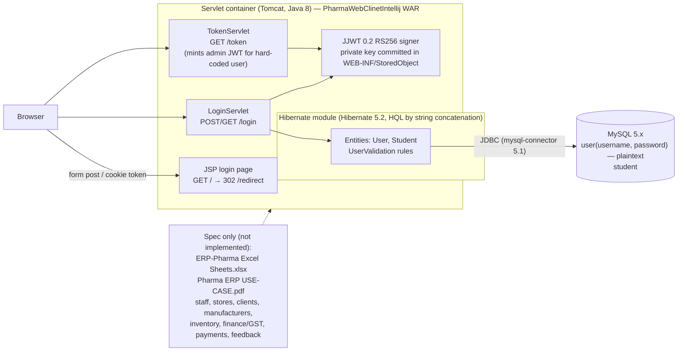
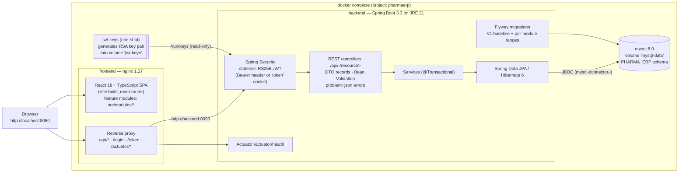
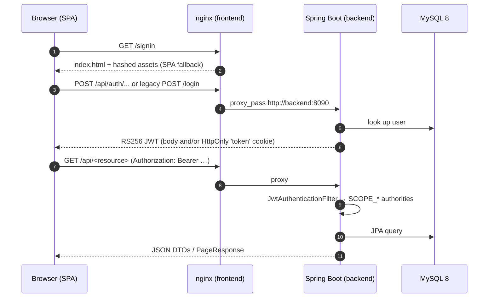

# Pharma ERP — architecture: legacy vs target

The modernisation replaces the Java 8 servlet/JSP application with a Spring Boot 3 REST backend and a React SPA,
packaged as a Docker Compose estate. The legacy code is kept unchanged in the repository and runs side by side in
the parity harness (`parity/legacy`) so behaviour can be compared flow by flow.

Detailed coding rules (module folders, Flyway ranges, test base classes) live in
[`modernisation/CONVENTIONS.md`](modernisation/CONVENTIONS.md). Operating the estate is covered in
[`RUNBOOK.md`](RUNBOOK.md).

## Legacy estate (as found)

- Build: Gradle 4.4 multi-project (`Hibernate`, `MainApp`, `PharmaWebClinetIntellij`), Java 8, no automated tests.
- Only authentication is implemented; every other business area exists solely as the spreadsheet / use-case PDF.
- Known defects (recorded in `parity/baseline`): plaintext passwords, `/token` issues an admin JWT to anyone,
  Hibernate exception text leaks to clients, RSA private key committed.

## Target estate (Docker Compose)

| Concern | Legacy | Target |
|---------|--------|--------|
| Runtime | Java 8, servlet container, exploded WAR | Java 21, Spring Boot 3.3 executable jar on `eclipse-temurin:21-jre` |
| Build | Gradle 4.4 (Groovy), no tests | Gradle 8 (Kotlin DSL, wrapper) + JUnit 5 / Testcontainers; Vite + Vitest |
| UI | JSP login page | React 18 + TypeScript SPA served by nginx |
| API | `/login`, `/token` servlets returning JSON strings | REST `/api/**` with JSON DTO records, OpenAPI at `/v3/api-docs`; legacy-compat `/login`, `/token` kept by the auth module |
| Persistence | Hibernate 5.2 XML config, HQL string concatenation, MySQL 5.x | Spring Data JPA / Hibernate 6, `ddl-auto=validate`, Flyway-managed MySQL 8 |
| Security | Plaintext passwords; RS256 key committed; `/token` mints admin tokens | Spring Security, stateless RS256 JWT (same claim shape), keys provided at runtime (`JWT_*_KEY_PATH`) |
| Errors | Exception text leaked / forwards to JSP | RFC 9457 `application/problem+json` (400 / 401 / 403 / 404 / 409) |
| Operations | Manual WAR deploy | `docker compose up -d --build`, health checks on every service, GitHub Actions CI |

## Request flow (target)

## Repository layout

| Path | Purpose |
|------|---------|
| `backend/` | Spring Boot application (`com.pharma.erp.<module>`), `backend/Dockerfile` |
| `frontend/` | Vite React SPA (`src/modules/<module>`), `frontend/Dockerfile`, `frontend/nginx.conf` |
| `docker-compose.yml` | Target estate (mysql, jwt-keys, backend, frontend) |
| `parity/` | Legacy estate in Docker + recorded flows and baseline transcripts |
| `.github/workflows/ci.yml` | Backend build/tests, frontend lint/test/build, compose smoke test |
| `Hibernate/`, `MainApp/`, `PharmaWebClinetIntellij/`, root Gradle files | Legacy source, kept unchanged for parity |
